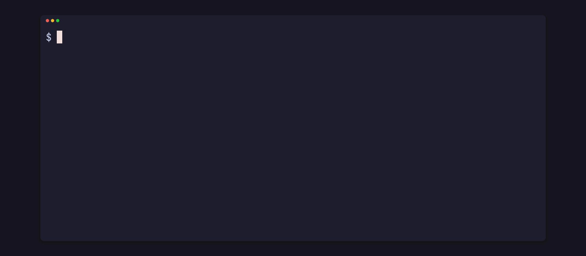

<p align="center"></p>

# pito-embed

[](https://github.com/gmrdad82/pito-embed/tags)

pito-embed turns text into embeddings on your own machine, in Rust: 768-number vectors where lines that mean the same thing sit close together, so you search by meaning instead of by words. It runs Google's EmbeddingGemma-300m on the GPU when there is one and on the CPU otherwise, with no network at inference time. Part of [PITO MD](https://pitomd.com).

- **6.3× faster on the GPU:** 256 lines embedded in 477 ms on Vulkan (536 lines a second) against 3,025 ms on the CPU, and one query in 17 ms against 29 ms ([how it was measured](#how-it-was-measured)).
- **Three calls:** `Embedder::load`, `embed_documents`, `embed_query`. Vectors come back unit length, so a dot product is the cosine similarity.
- **Picks the device for you:** the `probe` crate finds the card and the best lane for the work; if the GPU refuses the model, it runs on the CPU and tells you why.
- **Offline and pinned:** the model (219 MB, q4) is read from a folder you give it, every file pinned to one upstream commit and its sha256; the library never downloads anything itself.
- **Small:** 1,218 lines of Rust across the two crates, unit tests included; 5 direct dependencies for `embed`, 3 for `probe`.

Works on Linux and macOS (Windows through WSL).

Got questions or doubts? Ping me on Discord: https://discord.gg/XsNcn3kYzn

## Install and first use

Clone it and run the example: it downloads the model once (219 MB, sha256 checked), loads it on your GPU and ranks eight lines against your query.

**Linux** (Debian and Ubuntu; other distributions need the same three packages):

```sh
sudo apt-get install -y build-essential pkg-config libssl-dev
git clone https://github.com/gmrdad82/pito-embed && cd pito-embed
cargo run --release --example search -- a hidden area
```

**macOS** (Xcode's command line tools):

```sh
xcode-select --install
git clone https://github.com/gmrdad82/pito-embed && cd pito-embed
cargo run --release --example search -- a hidden area
```

**Windows:** run the Linux lines inside WSL.

It needs Rust 1.97 or newer. The build downloads ONNX Runtime's prebuilt libraries through the [`ort`](https://github.com/pykeio/ort) crate. Then add it to your project, pinned to a tag (it isn't on crates.io; both crates come from this repository and pin the same tag):

```toml
[dependencies]
embed = { git = "https://github.com/gmrdad82/pito-embed.git", tag = "v1.0.6" }
probe = { git = "https://github.com/gmrdad82/pito-embed.git", tag = "v1.0.6" }
```

## Search by meaning

The clip at the top is `examples/search.rs`. The whole of it that matters:

```rust
use embed::{EmbedDevice, Embedder};

let lane = probe::probe_machine().filing;
let device = EmbedDevice::try_from(lane).unwrap_or(EmbedDevice::Cpu);
let mut embedder = Embedder::load("path/to/embeddinggemma-300m-q4", device)?;

let docs = embedder.embed_documents(&["found a secret room behind the waterfall"])?;
let query = embedder.embed_query("a hidden area")?;
let score: f32 = query.iter().zip(&docs[0]).map(|(a, b)| a * b).sum();
```

```text
loaded EmbeddingGemma-300m on Vulkan in 1613 ms
embedded 8 lines and the query in 110 ms, 768 dimensions each

query: a hidden area
  0.567  found a secret room behind the waterfall
  0.295  we finally beat the final boss on hard
  0.289  the soundtrack in this level is incredible
```

"a hidden area" shares no word with "a secret room behind the waterfall", and it still ranks first. EmbeddingGemma's query and document prompts are applied for you. Errors are `EmbedError`: the model missing (with the file's path), the GPU unavailable, the model failing to load, or inference failing.

## Fast on the GPU, safe on the CPU


Batches are where the card pays: 6.3× the CPU on 256 lines. A single query is 1.7× faster. Loading the model and the first query cost more on the GPU, since its shaders are set up then, so load once and keep the `Embedder`.

| OS | GPU | Fallback |
| --- | --- | --- |
| Linux | ONNX Runtime's WebGPU provider over Vulkan (the default `vulkan` feature) | CPU |
| macOS | CoreML | CPU |

When the card refuses the model, `Embedder::load` loads it on the CPU instead; `device_in_use()` says where it runs and `fall_off_reason()` says why. For a CPU-only build, turn off the default features: `embed = { …, default-features = false }`.

<p align="center"></p>

`examples/bench.rs` prints the table above for your own machine:

```sh
PITO_EMBED_MODELS=<the model's folder> cargo run --release --example bench
```

The clip was recorded while the machine was busy rendering, so its CPU row is slower than the chart's; the chart is the quiet run.

### How it was measured

One run of `examples/bench.rs`, release build, on 2026-10-14: an AMD Radeon RX 9060 XT (16 GB) on Vulkan (Mesa RADV) against an AMD Ryzen 9 9950X (16 cores, 32 threads) with ONNX Runtime's CPU provider, Linux, EmbeddingGemma-300m q4 at the pinned commit, with the library code of v1.0.0. "One query" is the median of 20 single queries; "256 lines" is 16 short lines repeated with a number, in 8 batches of 32. The GPU shared its queue with one other job during the run. The data is [docs/bench/speed.toml](docs/bench/speed.toml), drawn by [pito-compare](https://github.com/gmrdad82/pito-compare). macOS (CoreML) builds and passes its tests on the CPU; its GPU path is untested on Apple hardware here.

## Know the machine

<p align="center"></p>

The `probe` crate answers what a program needs before it picks a device: the system, the card and its memory, the cores and RAM, the best execution lane for each kind of work (embeddings, speech, video), every graphics adapter (through wgpu) and the free disk space. `embed` reads it to pick a device. The clip is `examples/machine.rs`:

```rust
let machine = probe::probe_machine();
println!("{}", machine.headline());
println!("{}", machine.spec_line());
println!("embeddings  {}", machine.filing.label());
let disk = probe::probe_disk(std::path::Path::new("."));
```

## The model, pinned

The library reads the model from a folder you give it and never downloads anything itself. `embed::catalog()` lists what that folder holds: EmbeddingGemma-300m in ONNX, q4 quantised (about 219 MB in all), from [onnx-community/embeddinggemma-300m-ONNX](https://huggingface.co/onnx-community/embeddinggemma-300m-ONNX) on Hugging Face, pinned to one commit, with each file's size and sha256. Each entry is a `fetch::FetchSpec` from [pito-fetch](https://github.com/gmrdad82/pito-fetch), which downloads it resumably and checks the hash; any downloader works, as long as it checks the sha256.

The examples keep the model in `$XDG_DATA_HOME/pito-embed/embeddinggemma-300m-q4` (`~/.local/share/…` when that isn't set) on Linux and `~/Library/Application Support/pito-embed/embeddinggemma-300m-q4` on macOS, or in the folder `PITO_EMBED_MODELS` names.

On Linux the GPU build links ONNX Runtime's `libwebgpu_dawn.so` (12 MB), which `ort` places next to your binary in `target/<profile>/`; `cargo run` and `cargo test` find it, and a binary you ship carries it alongside (with an rpath of `$ORIGIN`, or `LD_LIBRARY_PATH`). The search example builds to 47 MB in release, ONNX Runtime included.

EmbeddingGemma is Google's model, provided under and subject to the [Gemma Terms of Use](https://ai.google.dev/gemma/terms) and the [Gemma Prohibited Use Policy](https://ai.google.dev/gemma/prohibited_use_policy). pito-embed ships no weights; whoever downloads and uses the model accepts those terms, which the MIT licence here doesn't cover.

## Build and test

```sh
bin/gate --fast
```

It runs `cargo fmt --all --check`, `cargo clippy --workspace --all-targets -- -D warnings`, the tests with [cargo-nextest](https://nexte.st) and the doc tests, and ends with `fast gate: green`. `bin/gate` without `--fast` is the full gate: the same, locked, plus the search example and the tests on the real model, and it needs `PITO_EMBED_MODELS` set.

On a build machine where cargo must stay offline, set `CARGO_NET_OFFLINE=true`: the gate first runs the workspace's `ort-cache` tool, which downloads the ONNX Runtime build `ort` pins into `ort`'s own cache (checking its sha256) only when it isn't there, then runs every cargo step with `--offline`. `cargo run -p ort-cache -- --check` prints that folder and says whether it is filled.

The tests that run the real model need it on disk: set `PITO_EMBED_MODELS` to the model's folder (running the search example once fills the default one). Without it they say so and skip. The maintainer runs all of it, with the model, on Linux and macOS before every release, and the GPU paths on a machine with a GPU.

## Part of PITO MD

pito-embed is one of the open building blocks of [PITO MD](https://pitomd.com). It downloads its model with [pito-fetch](https://github.com/gmrdad82/pito-fetch), and its clips and charts are made with [prec](https://github.com/gmrdad82/prec), [pcod](https://github.com/gmrdad82/pito-codecs) and [pito-compare](https://github.com/gmrdad82/pito-compare).

## Contributing

Issues are welcome at [github.com/gmrdad82/pito-embed/issues](https://github.com/gmrdad82/pito-embed/issues): a machine where the GPU isn't picked or falls back when it shouldn't (with what `examples/machine.rs` prints), a load or inference error, or results that look wrong. Pull requests aren't taken. Please read the [code of conduct](CODE_OF_CONDUCT.md) first, and report security issues privately, as [SECURITY.md](SECURITY.md) describes.

## Licence


The code is MIT licensed ([LICENSE](LICENSE)), © Catalin Ilinca. The model is Google's, under the Gemma Terms of Use, and the third-party notices are in [NOTICE](NOTICE). The PITO MD name and its logos are © Catalin Ilinca, all rights reserved, and are not covered by the MIT licence ([TRADEMARKS.md](TRADEMARKS.md)).
